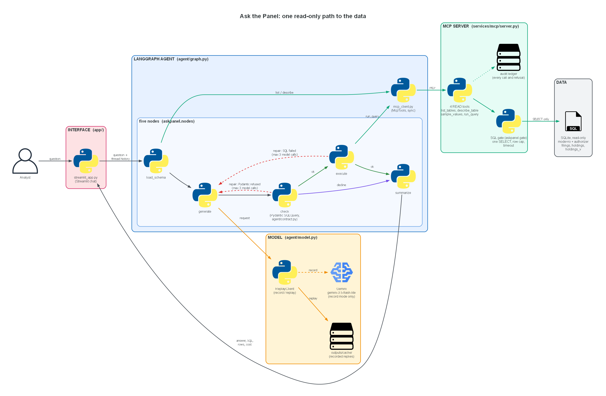
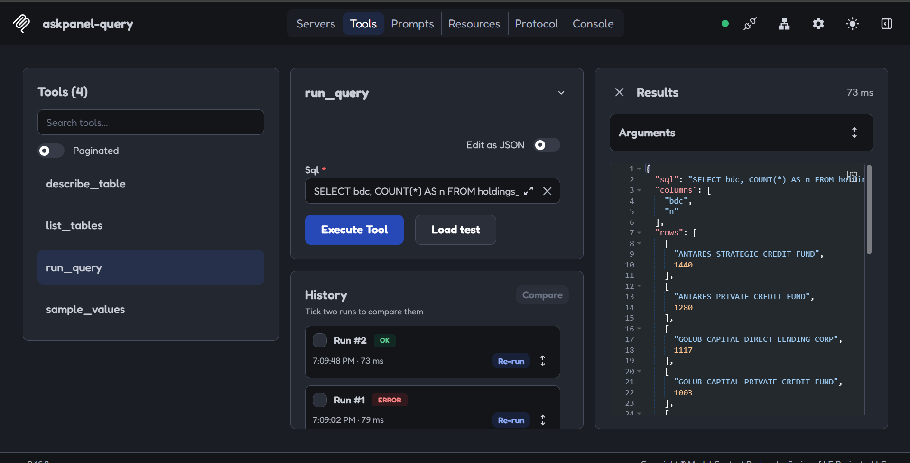
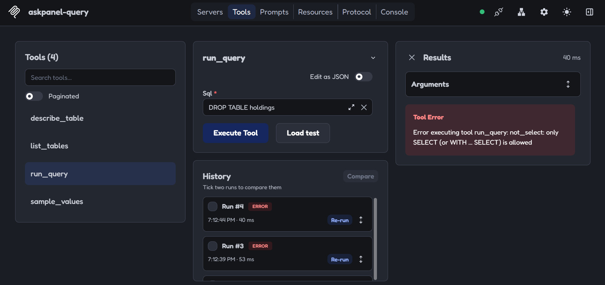

# Lab 4B: Ask the Panel (Project LANTERN, Part 4B)

A natural-language query interface over the BDC panel. An analyst types a question; a LangGraph
agent asks Gemini for ONE SQL query as a Pydantic object, a read-only MCP server runs it, and the
answer comes back with the rows and the SQL behind it.

Built on the real Lab 3B panel: 72 BDC filings, 21,944 current holdings, period 2025-12-31.
Model: `gemini-3.5-flash-lite`, recorded once and replayed from `outputs/cache/` (no key needed).

**Demo video (under 10 minutes):** [Watch on Google Drive](https://drive.google.com/file/d/1mfk4bGIFduw5CiG_ecTTq2W524BoX6Py/view?usp=sharing)

## Setup and reproducibility (no API key needed)

```
cd cs4b
python -m venv .venv
source .venv/bin/activate              # Windows PowerShell: .venv\Scripts\Activate.ps1
pip install -r requirements.txt
python tests/run_tests.py              # 26/26 kit tests
python tools/build_db.py               # rebuilds data/panel.sqlite from data/real/ (gitignored)
pytest -q tests/test_server.py         # the MCP server: catalog, SELECT, refusals
python agent/run.py --mode replay      # answers the ten questions from the cache
PYTHONPATH=src python -m askpanel.check   # 12/12   (PowerShell: $env:PYTHONPATH = "src")
streamlit run app/streamlit_app.py     # the chat app, replay by default
```

Record mode (only to re-record): set `GEMINI_API_KEY` (a free Google AI Studio key) and run
`python agent/run.py --mode record`. The key is never committed.

## Architecture



Drawn by `python tools/architecture.py` (needs Graphviz and `pip install diagrams`; drawing only).

- **One path to the data.** Nothing in `agent/` or `app/` imports `sqlite3` or opens the database;
  the server opens it with `gate.connect_ro` (read-only + authorizer) and runs every query through
  `gate.run_query` (one statement, row cap, timeout).
- **Rules twice.** The agent's Pydantic `SQLQuery` (`agent/contract.py`) refuses bad SQL before any
  call; the server's gate is the authority.
- **Closed catalog.** `list_tables`, `describe_table`, `sample_values`, `run_query`, all READ.
  Every call and every refusal is written to the audit ledger (`outputs/ledger.jsonl`, gitignored).
- **Repair, capped.** A refused or failed query goes back to `generate` with its error code and the
  failed SQL, at most 3 model calls per question; a budget guard stops runaway cost.
- **Follow-ups.** The checkpointer keeps each thread's history (question + SQL); a follow-up reuses
  its parent's thread.

## What is where

| File | Part |
|---|---|
| `sql/holdings_v.sql` | 0: the view (one row per current holding, `price`, `is_debt`) |
| `tools/clean_panel.py` | 0: drops unfunded commitments, keeps written-off loans at fair value 0 |
| `agent/contract.py`, `tests/test_contract.py` | 1: the Pydantic contract and its refusal tests |
| `services/mcp/server.py`, `tests/test_server.py` | 2: the MCP query server and its tests |
| `agent/mcp_client.py` | 2: one long-lived MCP session for the synchronous agent and app |
| `agent/model.py`, `agent/graph.py`, `agent/run.py` | 3: Gemini behind record/replay, the graph, the runner |
| `app/streamlit_app.py` | 4: the chat app |
| `questions/questions.yaml`, `outputs/questions/`, `outputs/cache/` | 5: ten questions, saved and replayable |
| `outputs/economics.md`, `tools/economics.py`, `outputs/economics_numbers.json` | 6: unit economics and the script behind every number |
| `outputs/failures.md` | 6: four failures, each with its fix |
| `tools/architecture.py`, `docs/` | the architecture diagram and the Inspector screenshots |

## Using the app

`streamlit run app/streamlit_app.py` shows, for each question: the answer, the SQL, the rows as a
table, the cost and number of model calls, and the trace (every graph step, including repairs).
"New conversation" starts a new thread.

In replay mode a question is answered only if it matches a recorded request exactly, history
included. Each recorded question was asked as the first in its own conversation, so: click
**New conversation**, then paste a question from `questions/questions.yaml`. q07 is the exception:
ask it right after q06 in the same conversation. Anything else shows a replay hint instead of
crashing; switch to record mode (with a key) to ask new questions.

## The ten questions

Asked word for word in the app, each as the first question of a new conversation (q07 right after
q06). Source: `questions/questions.yaml`; saved answers: `outputs/questions/<id>.json`.

| id | category | question | outcome | calls | cost |
|---|---|---|---|---|---|
| q01 | lookup | What is the largest single holding by fair value in Fidus Investment Corp's current schedule? | answered, repaired (invalid column `adsch`) | 2 | $0.00115 |
| q02 | lookup | Which current holding at Blackstone Secured Lending Fund has the highest PIK rate, and what is that rate? | answered | 1 | $0.00062 |
| q03 | aggregation | What share of Antares Strategic Credit Fund's current fair value is first lien debt? | answered (also returns the sibling fund, see limitations) | 1 | $0.00069 |
| q04 | aggregation | How many current holdings does Morgan Stanley Direct Lending Fund report, and what is their total fair value? | answered | 1 | $0.00061 |
| q05 | cross_bdc | Which five BDCs have the largest total fair value in their current schedules? | answered | 1 | $0.00060 |
| q06 | cross_bdc | Which ten BDCs have the lowest average price across their current debt holdings? | answered | 1 | $0.00061 |
| q07 | follow_up (q06) | Which holdings pull the lowest of those averages down the most? | answered, repaired (two timeouts) | 3 | $0.00241 |
| q08 | over_time | How did Kennedy Lewis Capital Co's total fair value and number of holdings change from the prior schedule to the current one? | answered | 1 | $0.00074 |
| q09 | over_time | Which five BDCs grew their total fair value the most, in dollars, from the prior schedule to the current one? | answered | 1 | $0.00094 |
| q10 | decline | Which of Golub Capital BDC 4's borrowers will default next year? | declined correctly | 1 | $0.00043 |

Totals: $0.00881 for 13 model calls (see `outputs/economics.md`).

## Inspector

The server in the MCP Inspector (`mcp dev services/mcp/server.py`): the four tools, a SELECT on the
real panel, and a write refused by the gate.




## Known limitations

- **Sibling funds (q03).** The name match `bdc LIKE 'ANTARES STRATEGIC CREDIT FUND%'` also catches
  ANTARES STRATEGIC CREDIT FUND II LLC; the answer groups by `bdc`, so the two funds are separate
  rows rather than one mixed total.
- **q07's scope.** "The lowest of those averages" means the single lowest BDC, but the SQL takes
  holdings from all ten low-average BDCs.
- **Undrawn commitments.** Some undrawn or partly drawn loans still show prices near 0, because the
  panel does not say how much of the principal is drawn.
- **Lien type and industry.** `investment_type` and `industry` are NULL in this panel; lien type is
  matched inside `identifier`.

## Policies

Public SEC data only; every person in the scenario is fictional. The agent reads and never writes.
Use of AI coding assistants follows the course policy.